# Descarte Fácil

Aplicativo mobile da CitizenTech **Descarte Fácil**, desenvolvido para a Global Solution 2026 da FIAP (Engenharia de Software, 3º ano), disciplina **Mobile Development & IoT**.

O app ajuda moradores de São Paulo a descartar móveis, eletrodomésticos e outros objetos grandes do jeito certo, principalmente quem não tem carro para levá-los a um ecoponto.

## Integrantes

| Nome | RM |
| --- | --- |
| Lorenzzo Vendruscolo Dias | RM558305 |
| Gabriel Martins Vannucci | RM556883 |
| Miguel Marques Lourenço | RM555426 |
| Pedro Henrique Ferronato | RM554757 |

## Ficha da CitizenTech

| Campo | Descrição |
| --- | --- |
| Nome | Descarte Fácil |
| Cidade e bairro | São Paulo, [bairro onde a equipe observou o problema] |
| Cidadão beneficiado | Morador sem carro que precisa descartar um móvel ou objeto grande, como idosos e pessoas que moram sozinhas |
| Problema, em uma frase | Quem não tem carro não sabe quando o Cata-Bagulho passa e acaba deixando o objeto na calçada fora da data |
| Como funciona | O app indica a destinação de cada objeto, mostra a data de coleta pelo CEP, registra a solicitação, avisa sobre a coleta programada e oferece o objeto para doação |
| O que cada parte faz | App mobile (este repositório); API em C# e circuito ESP32 no Wokwi desenvolvidos por outros integrantes |
| Link do repositório | [link] |
| Indicador de impacto | Objetos registrados para coleta ou doados pelo app; queda de chamados de descarte irregular no bairro (SP156) |
| ODS conectados | 10, 11 e 12 |

### Problema identificado

São Paulo tem cerca de 1.400 pontos frequentes de descarte irregular, segundo a própria prefeitura, mesmo com 128 ecopontos e com o Cata-Bagulho, serviço gratuito que recolhe objetos volumosos na porta de casa. O ecoponto exige transporte próprio, e as datas do Cata-Bagulho ficam espalhadas em páginas de subprefeituras. Sem saber a data, parte dos moradores deixa o objeto na rua.

### Público beneficiado

- Moradores sem veículo próprio.
- Idosos e pessoas que moram sozinhas.
- Agentes de coleta, que passam a ver os objetos agendados por bairro.

### Hipóteses

1. Moradores deixam objetos na rua porque não sabem a data do Cata-Bagulho.
2. Ver a data e receber um aviso dentro do app aumenta o descarte correto.
3. Parte dos objetos ainda serve e pode ser doada em vez de descartada.

### ODS relacionados

- **ODS 10 – Redução das desigualdades:** quem não tem carro passa a ter um caminho claro para descartar sem transporte próprio.
- **ODS 11 – Cidades e comunidades sustentáveis:** menos objetos abandonados em calçadas e pontos viciados.
- **ODS 12 – Consumo e produção responsáveis:** incentivo à doação e ao reaproveitamento antes do descarte.

### Entrevista com um cidadão real

Para compreender as dificuldades enfrentadas pelos moradores de São Paulo no descarte de objetos volumosos, foi realizada uma entrevista com um cidadão que já precisou utilizar um serviço de descarte na cidade.

**Perguntas e respostas:**

1. **Você já precisou descartar algum móvel ou objeto grande?**
   - Sim.

2. **Como fez para descartar?**
   - Deslocou-se até um centro de descarte localizado na Vila Mariana, em São Paulo.

3. **Teve alguma dificuldade para encontrar um local ou serviço de coleta?**
   - Sim.

4. **Você conhece o Cata-Bagulho ou os ecopontos de São Paulo?**
   - Sim.

5. **Um aplicativo que mostrasse as datas de coleta, os ecopontos e permitisse doar objetos seria útil para você?**
   - Sim.

**Análise da entrevista**

A entrevista identificou que, mesmo conhecendo os serviços de descarte disponíveis em São Paulo, o cidadão enfrentou dificuldades para encontrar uma alternativa adequada e precisou se deslocar até um centro de descarte.

As respostas reforçam a relevância de centralizar informações sobre ecopontos, datas do Cata-Bagulho e possibilidades de doação em uma única plataforma.

O Descarte Fácil busca facilitar o acesso a essas informações e orientar os moradores sobre alternativas para a destinação correta de objetos volumosos.

**Conclusão**

O entrevistado considerou útil a proposta do aplicativo. Esse retorno oferece uma validação qualitativa inicial do problema e da solução proposta, embora não represente uma avaliação abrangente da população.

## Funcionalidades

### Perfil Cidadão

- **Início:** saudação, próxima coleta, resumo das solicitações, aviso de coleta programada nos próximos 7 dias, aviso de coleta não realizada e atalhos.
- **Descartar:** formulário com nome, categoria, descrição, foto (câmera ou galeria), CEP com máscara, endereço e bairro. Mostra a destinação indicada para a categoria e a data de coleta encontrada para o CEP. Objetos que não vão para a calçada (entulho, poda, eletrônicos pequenos) recebem a orientação, sem registro de coleta.
- **Minhas solicitações:** histórico com filtro por situação, detalhes, linha do tempo de status e cancelamento.
- **Cata-Bagulho:** consulta de CEP com validação de 8 dígitos, próxima data na base demonstrativa, explicação do serviço, coletas programadas do usuário e atalho para registrar um objeto na data encontrada.
- **Doações:** lista de objetos disponíveis, cadastro com telefone obrigatório e validado, contato por ligação ou WhatsApp com mensagem pré-preenchida, detalhes da doação e opção de marcar o objeto como indisponível. Os registros são armazenados localmente no aparelho.
- **Ecopontos:** endereço, horário, ocupação simulada da caçamba, indicador de disponibilidade e alerta acima de 90%.

### Perfil Agente

- **Agendamentos:** lista de todas as solicitações do aparelho, com filtro por situação e bairro visível.
- **Detalhes:** dados do objeto, foto, endereço completo e histórico.
- **Atualização de status:** confirmar coleta, registrar que não foi possível coletar ou reabrir o agendamento. Cada alteração fica salva e entra no histórico.

### Comum aos dois perfis

- Login com Context API e sessão salva no aparelho.
- Tela de conta com opção de restaurar os dados de demonstração e sair.

## Credenciais de demonstração

| Perfil | E-mail | Senha |
| --- | --- | --- |
| Cidadão | `cidadao@descartefacil.demo` | `demo123` |
| Agente | `agente@descartefacil.demo` | `demo123` |

Na tela de login, os botões **Cidadão** e **Agente** preenchem essas credenciais.

> A autenticação é local e existe apenas para fins acadêmicos. As senhas ficam no código do app, o que não é adequado para produção.

## Dados simulados

Nada no app vem de uma API ou de um sistema oficial. Os dados demonstrativos estão em `src/data/` e são identificados na interface.

| Dado | Origem |
| --- | --- |
| Datas do Cata-Bagulho | Base demonstrativa criada pela equipe (`setoresCataBagulho.ts`). Cada faixa de CEP recebe um dia fixo do mês, por exemplo "3º sábado". **Não é o calendário oficial** e o app não tem integração com a Prefeitura de São Paulo. A tela oferece o link do calendário oficial. |
| Ecopontos | Nome e endereço conforme a página da Subprefeitura Vila Prudente, consultada em novembro de 2026. Horários conforme a prefeitura. A **ocupação é simulada**. |
| Solicitações e doações iniciais | Registros fictícios (`registrosIniciais.ts`) com endereços marcados como "endereço demonstrativo". As datas são calculadas a partir do dia em que o app é aberto, usando a mesma base do Cata-Bagulho. |
| Classificação do objeto | Regras locais por categoria (`categorias.ts`). Não há reconhecimento por inteligência artificial. |
| Usuários | Duas contas fictícias (`usuarios.ts`). |

Os dados iniciais são gravados no AsyncStorage na primeira execução e marcados com `origem: 'demonstracao'`. Tudo o que o usuário cria recebe `origem: 'usuario'`. As doações e solicitações existem apenas no aparelho em uso e não são sincronizadas entre usuários.

## Simulação IoT

A tela de Ecopontos representa o comportamento esperado de sensores ultrassônicos instalados nas caçambas. **Não existe sensor físico, ESP32, MQTT ou Wokwi conectado ao app.** O circuito no Wokwi é uma entrega separada da disciplina de Physical Computing.

Como funciona (`src/services/iotSimulator.ts` e `src/hooks/useSensoresEcopontos.ts`):

1. Cada ecoponto começa com uma ocupação inicial definida nos dados demonstrativos.
2. A cada 3 segundos, enquanto a tela está aberta, uma nova leitura é gerada: a ocupação varia entre -1 e +4 pontos percentuais, sempre limitada entre 0% e 100%.
3. Quando a caçamba chega a 100%, há 25% de chance por leitura de ela ser trocada por uma vazia.
4. A leitura é classificada como **Disponível** (abaixo de 70%), **Quase cheio** (70% a 90%) ou **Lotado** (acima de 90%).
5. Quando um ecoponto passa a ficar lotado, aparece um alerta no topo da tela.
6. O botão **Simular lotação** leva o ecoponto a 95% para demonstrar o alerta na hora.

Ao sair da tela, o intervalo é encerrado.

## Tecnologias

- React Native com Expo (SDK 54) e TypeScript
- Expo Router para navegação por arquivos
- Context API para autenticação e sessão
- AsyncStorage para persistência local
- expo-image-picker para câmera e galeria
- @expo/vector-icons (Feather) para ícones

## Arquitetura

O app é dividido em camadas. As telas não acessam o AsyncStorage diretamente: elas chamam os serviços.

```
Telas (app/)  →  Hooks e Context (src/hooks, src/contexts)  →  Serviços (src/services)  →  AsyncStorage
                                                                     ↑
                                                         Dados iniciais (src/data)
```

- **Rotas e telas (`app/`):** cada arquivo é uma rota do Expo Router. Os grupos `(cidadao)` e `(agente)` têm layouts que verificam o perfil logado e redirecionam quem não tem acesso.
- **Componentes (`src/components/`):** botões, campos, avisos, estados de carregamento, erro e lista vazia, reutilizados em todas as telas.
- **Contexto (`src/contexts/AuthContext.tsx`):** guarda o usuário logado e expõe `entrar` e `sair`.
- **Serviços (`src/services/`):** toda leitura e gravação de dados, mais a simulação IoT e a consulta do Cata-Bagulho.
- **Dados (`src/data/`):** categorias, ecopontos, setores do Cata-Bagulho, usuários e registros iniciais.
- **Tipos (`src/types/`), tema (`src/theme/`), constantes (`src/constants/`) e utilitários (`src/utils/`):** máscaras, validações e datas.

### Preparado para integração futura

Os serviços `solicitacaoService.ts` e `doacaoService.ts` são o único ponto de acesso aos dados. Para usar a API em C# do grupo, basta trocar a implementação dessas funções por chamadas HTTP mantendo as mesmas assinaturas; as telas não mudam. Essa integração **não** foi implementada.

## Estrutura de pastas

```
descarte-facil/
├── app/
│   ├── _layout.tsx                 Provedores e navegação raiz
│   ├── index.tsx                   Redireciona conforme a sessão
│   ├── login.tsx
│   ├── (cidadao)/
│   │   ├── _layout.tsx             Abas do cidadão e proteção do perfil
│   │   ├── inicio.tsx
│   │   ├── descartar.tsx
│   │   ├── cata-bagulho.tsx
│   │   ├── ecopontos.tsx
│   │   ├── conta.tsx
│   │   ├── doacoes/                Lista, nova doação e detalhes
│   │   └── solicitacoes/           Histórico e detalhes
│   └── (agente)/
│       ├── _layout.tsx             Abas do agente e proteção do perfil
│       ├── agente-conta.tsx
│       └── agendamentos/           Lista e detalhes com atualização de status
├── src/
│   ├── components/
│   ├── constants/
│   ├── contexts/
│   ├── data/
│   ├── hooks/
│   ├── services/
│   ├── theme/
│   ├── types/
│   └── utils/
├── docs/
│   ├── AZURE_BOARDS.md             Features e casos de teste para Testing
│   └── screenshots/                Prints das telas
├── prompts.md
├── app.json
├── package.json
└── tsconfig.json
```

## Como executar no Windows (VS Code)

### Pré-requisitos

- [Node.js](https://nodejs.org/) LTS (versão 20 ou mais recente)
- [Visual Studio Code](https://code.visualstudio.com/)
- Aplicativo **Expo Go** no celular (Android ou iOS)

### Passo a passo

1. Extraia o ZIP e abra a pasta `descarte-facil` no VS Code (**Arquivo > Abrir Pasta**).
2. Abra o terminal integrado (**Terminal > Novo Terminal**).
3. Instale as dependências:
   ```bash
   npm install
   ```
4. Alinhe as versões das bibliotecas com a versão do Expo instalada:
   ```bash
   npx expo install --fix
   ```
5. Inicie o projeto:
   ```bash
   npx expo start
   ```
6. Escaneie o QR Code com o Expo Go (Android) ou com a câmera (iOS). O celular e o computador precisam estar na mesma rede Wi-Fi. Se não conectar, use `npx expo start --tunnel`.
7. Para abrir no navegador, pressione `w` no terminal.

Para verificar a tipagem: `npm run typecheck`.

### Se o Expo Go pedir outra versão do SDK

O Expo Go da loja só abre projetos da versão mais recente do SDK. Se aparecer uma mensagem de incompatibilidade, atualize o projeto:

```bash
npx expo install expo@latest
npx expo install --fix
```

## Limitações conhecidas

- Sem backend: os dados ficam apenas no aparelho e não há sincronização entre usuários.
- Datas do Cata-Bagulho e ocupação dos ecopontos são simuladas.
- A autenticação é local e não protege os dados.
- Fotos são guardadas pelo endereço do arquivo no aparelho; se o arquivo for apagado do cache, a imagem deixa de aparecer.
- O aviso de coleta é exibido dentro do app; não há notificação push.
- A base de ecopontos tem apenas os três endereços da Subprefeitura Vila Prudente.


## Evidências

As capturas de tela demonstram as principais funcionalidades do aplicativo Descarte Fácil, desenvolvido para a Global Solution da FIAP.

### 1. Autenticação e tela inicial

| Login | Início do cidadão |
| --- | --- |
| 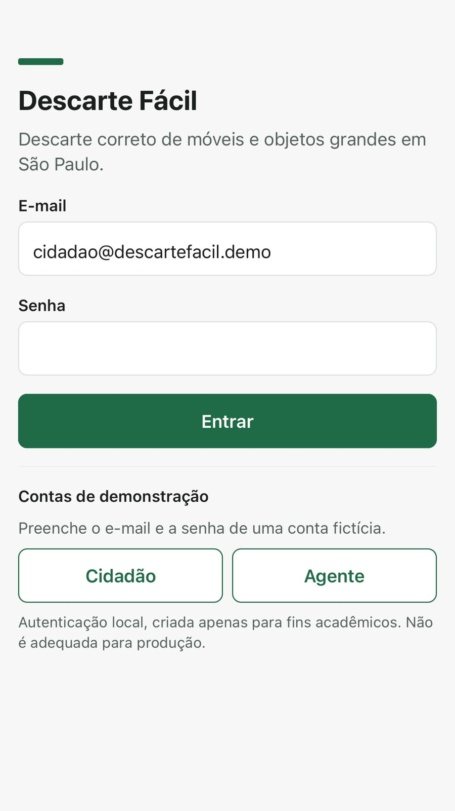 | 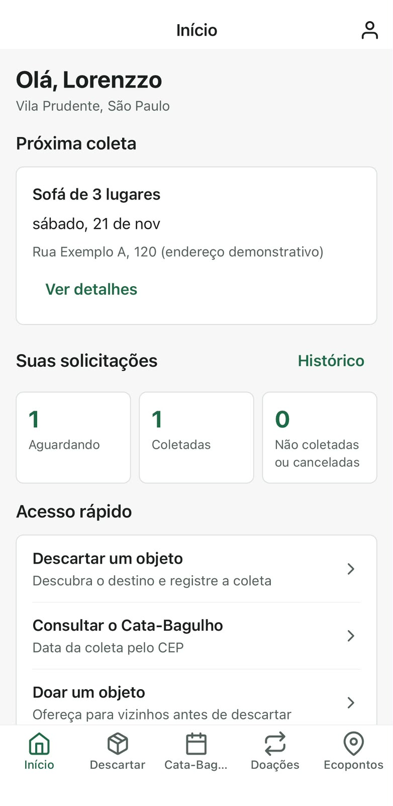 |

### 2. Descarte e Cata-Bagulho

| Cadastro de descarte | Consulta Cata-Bagulho |
| --- | --- |
| 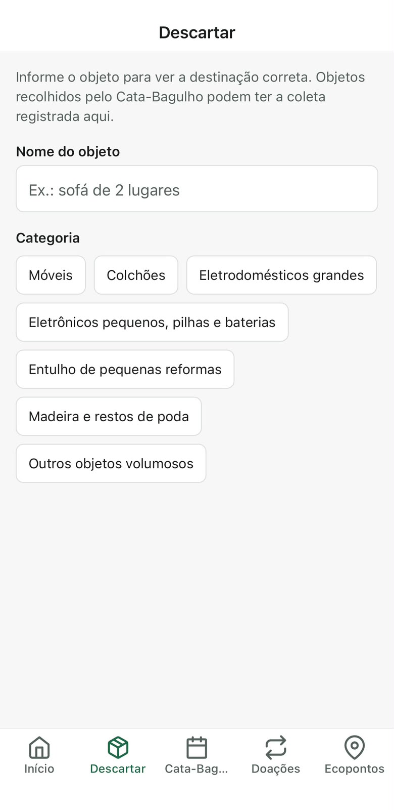 | 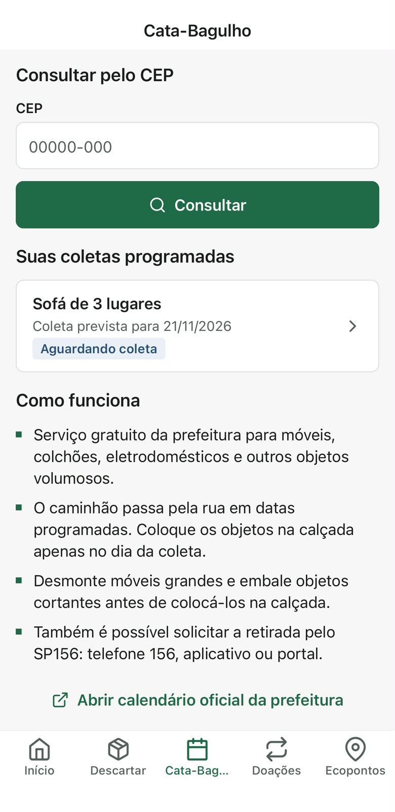 |

**Resultado da consulta por CEP:**

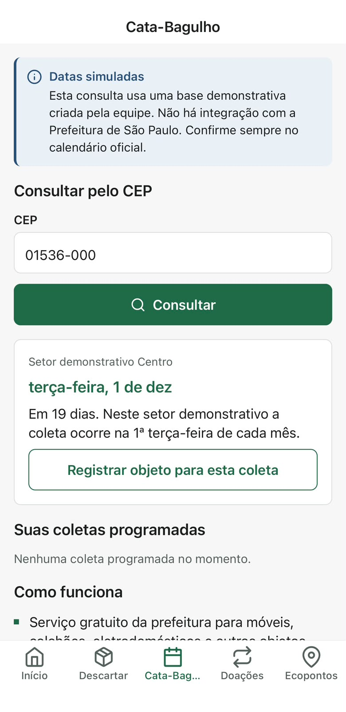

### 3. Doações

| Lista de doações | Cadastro de doação |
| --- | --- |
| 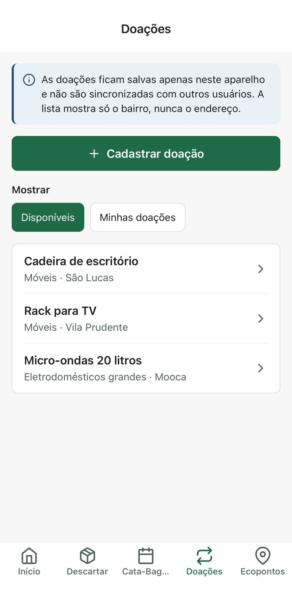 | 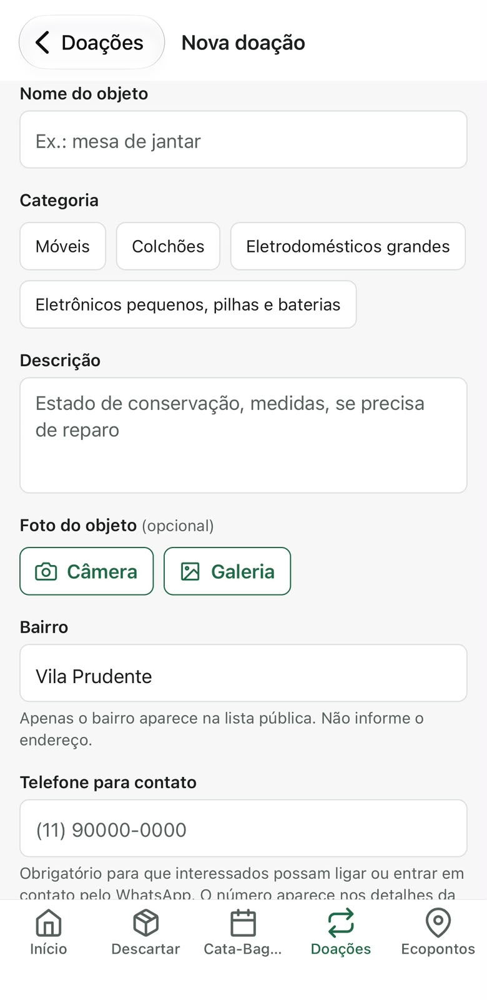 |

| Detalhes da doação | Contato pelo WhatsApp |
| --- | --- |
| 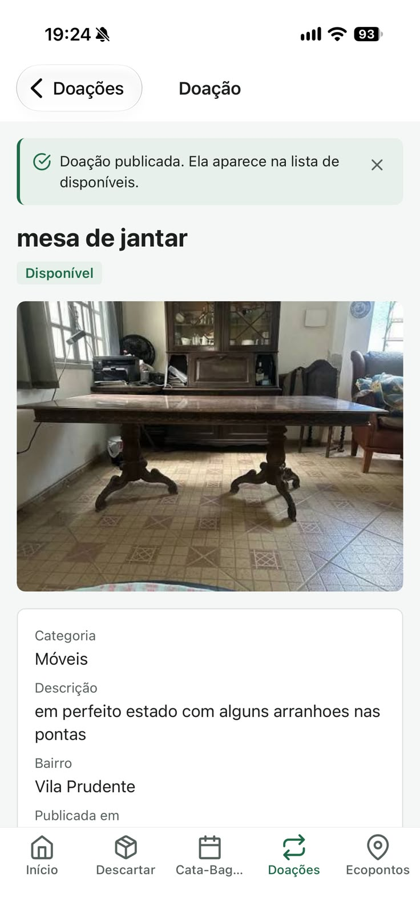 | 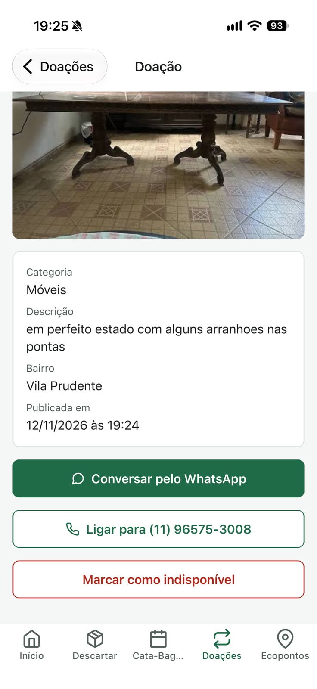 |

### 4. Histórico de solicitações

| Histórico | Detalhes da coleta |
| --- | --- |
| 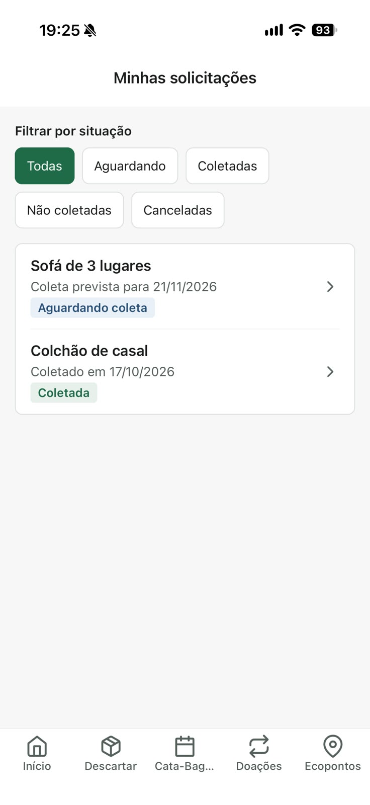 | 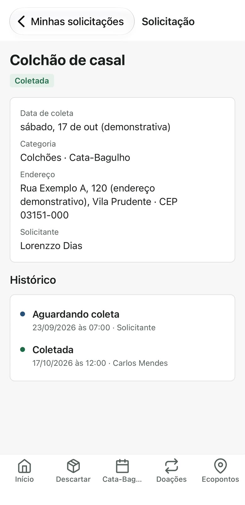 |

### 5. Ecopontos e simulação IoT

Os níveis de ocupação das caçambas são simulados. O aplicativo apresenta alertas quando a ocupação ultrapassa 90%.

| Monitoramento IoT | Alerta de lotação |
| --- | --- |
| 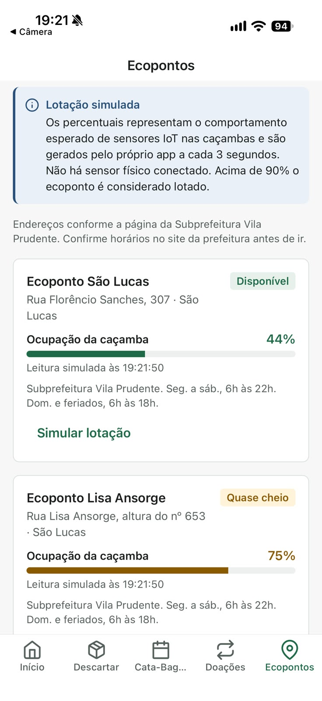 | 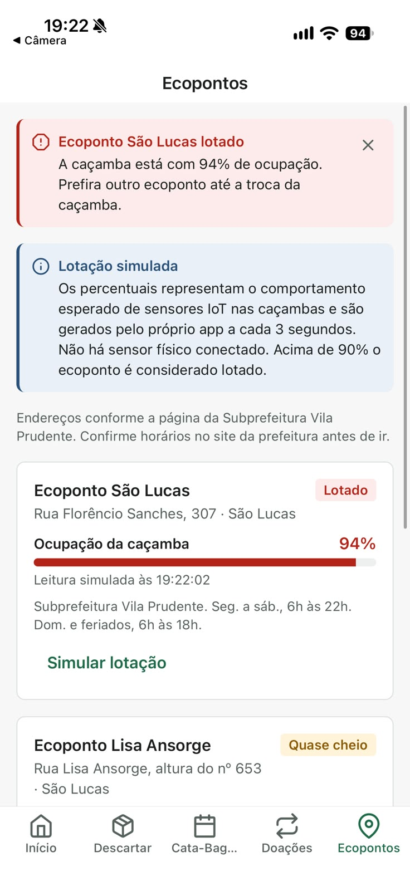 |

### 6. Agente de coleta

| Agendamentos | Detalhes do agendamento |
| --- | --- |
| 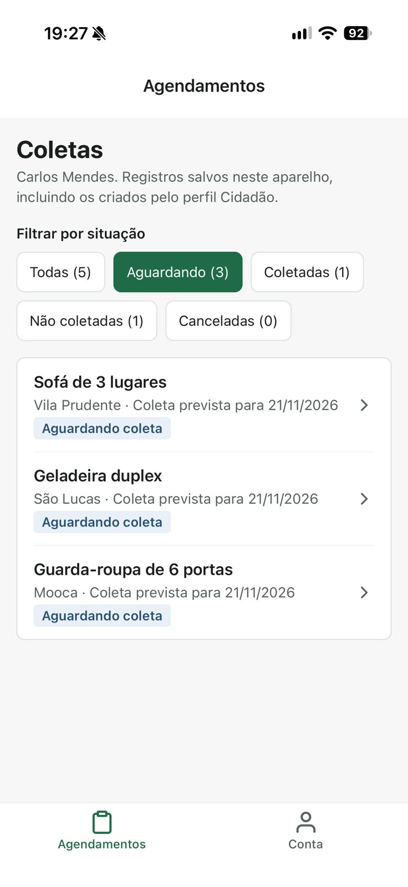 | 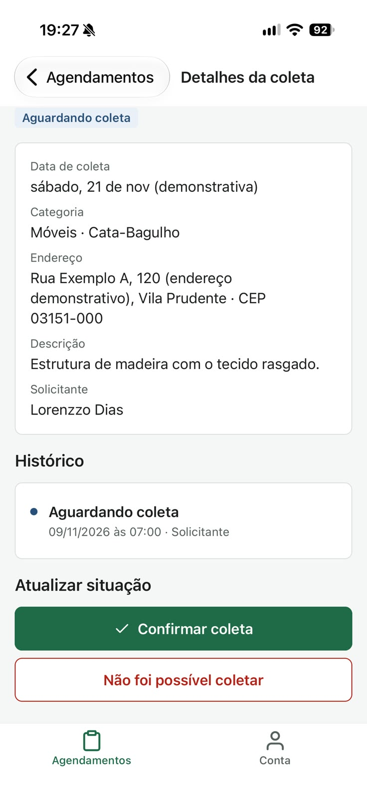 |

**Registro de coleta não realizada:**

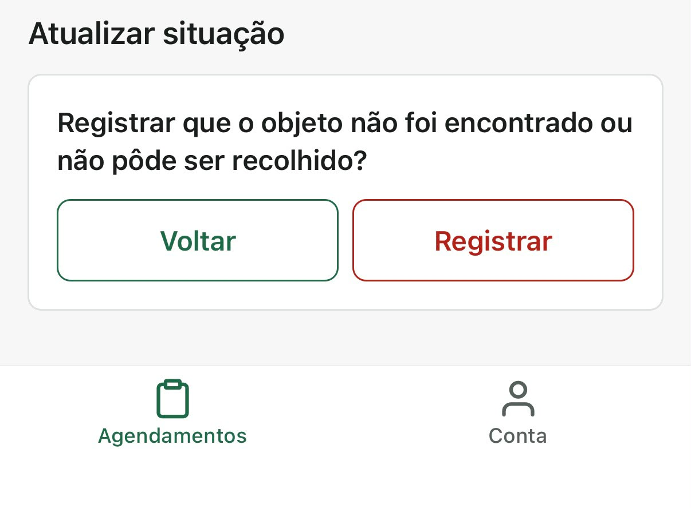

**Solicitação não coletada:**

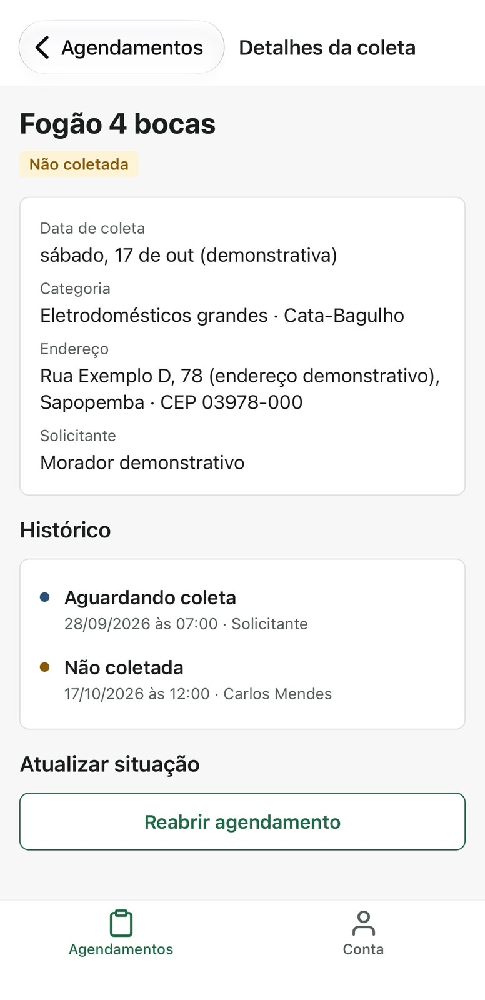

**Conta do agente:**

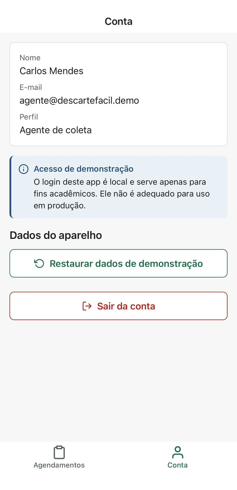

### Observações

- Os dados são demonstrativos e utilizados para fins acadêmicos.
- A consulta do Cata-Bagulho não possui integração com a Prefeitura de São Paulo.
- Os níveis de ocupação IoT são simulados, sem sensores físicos conectados.
- As informações são armazenadas localmente no dispositivo.


## Vídeo demonstrativo

Link: [adicionar link do vídeo]

Roteiro sugerido para até 3 minutos:

1. **0:00–0:20** Problema e público, em uma frase cada.
2. **0:20–0:40** Login como Cidadão e tela inicial.
3. **0:40–1:20** Descartar um sofá: categoria, destinação, foto, CEP com data e confirmação. Mostrar um erro de validação.
4. **1:20–1:40** Consulta do Cata-Bagulho pelo CEP.
5. **1:40–2:00** Cadastro de uma doação com telefone.
6. **2:00–2:25** Ecopontos: leituras mudando e "Simular lotação" gerando o alerta.
7. **2:25–2:50** Login como Agente: filtrar, abrir o sofá registrado e confirmar a coleta.
8. **2:50–3:00** Voltar como Cidadão e mostrar o status "Coletada" no histórico, comprovando a persistência.

## Uso de IA

O desenvolvimento contou com IA como copiloto. Os prompts estão registrados em [`prompts.md`](./prompts.md).
